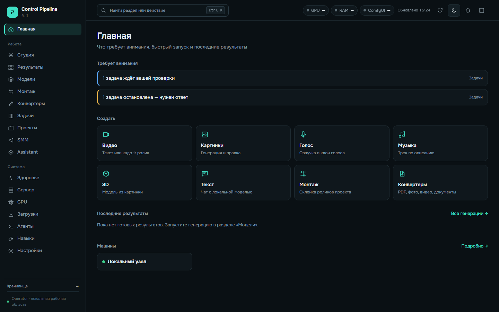
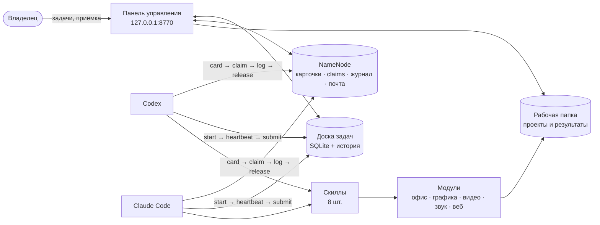
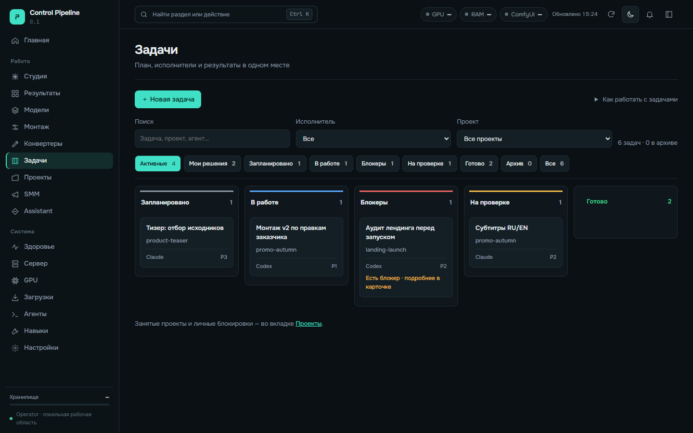
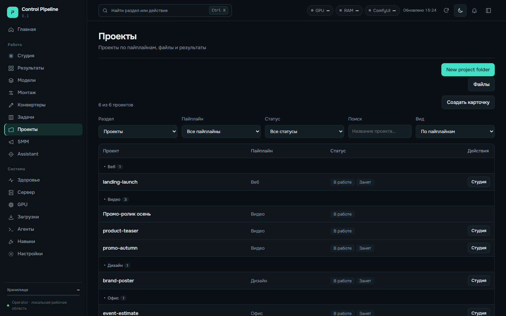
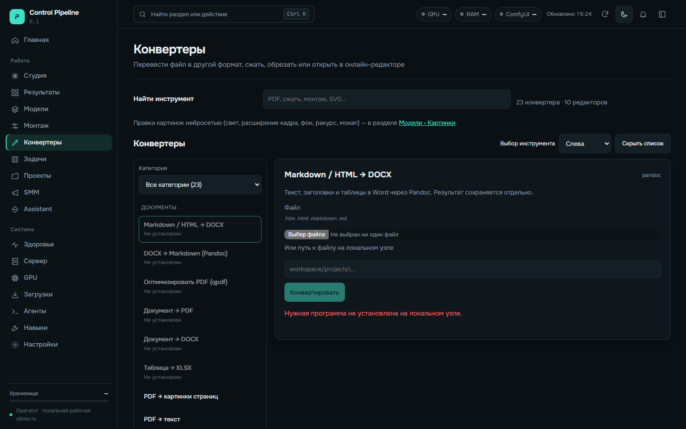
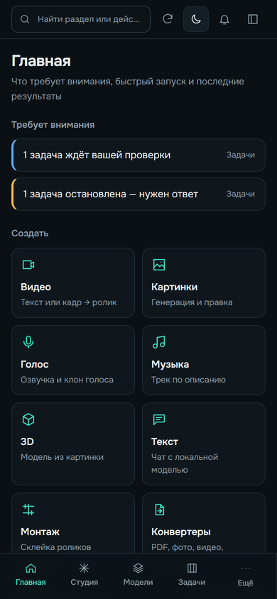

# Pipeline Kit

**Локальный штаб для команды AI-агентов.** Codex, Claude Code и другие агенты работают над общими проектами и не мешают друг другу. Каждый знает, где лежат файлы, кто чем занят, что нужно сдать и чем это доказать. Владелец видит всё в одной панели и сам принимает результат.

   



**В одной папке:**

- **Панель управления** — проекты, доска задач, студия с чатами и монтажом, 23 конвертера, мобильная версия.
- **NameNode** — карта проектов для агентов: карточки, захват работы (claim), журнал, почта между агентами.
- **8 готовых скиллов** для Codex и Claude Code: от доски задач до печатной графики и сведения звука.
- **[Каталог скиллов](docs/SKILLS.ru.md): 69 авторских** по дизайну, видео, музыке, играм, офису, вебу, Telegram и SMM, плюс **55 проверенных сторонних** со ссылкой на upstream и лицензией.
- **5 производственных модулей**: офис, графика, видео, звук, веб. Это 27 скриптов, все работают локально.
- **Автонастройка силами агента.** Агент опрашивает владельца, изучает компьютер и сам ставит только нужное: 8 профилей установки.

Без облака, подписок и телеметрии. Ничего не запускается само: внешние модели, GPU и платные вызовы подключаются отдельно и только по вашему решению.

> **English summary.** Pipeline Kit is a local-first control room for AI coding agents (Codex, Claude Code) working on shared creative and office projects. It bundles a FastAPI control panel (projects, task board, studio, converters, mobile UI), NameNode (project cards, work claims, journal and agent-to-agent mailbox), 8 agent skills plus a catalog of 69 authored and 55 vetted third-party skills ([docs/SKILLS.ru.md](docs/SKILLS.ru.md)), and 27 CPU scripts for estimates, layered graphics, print preflight, FFmpeg montage, loudness mastering and offline SEO/UTM. No cloud calls, no telemetry. Python 3.12. UI and docs are in Russian; module reference is in English ([docs/MODULES.md](docs/MODULES.md)).

---

## Зачем это нужно

Когда над проектами работают несколько агентов, ломается одно и то же:

| Проблема | Что делает Pipeline Kit |
| --- | --- |
| Агент не знает, где лежит проект и куда вносить правки | Карточка NameNode: путь, репозиторий, правила, «куда вносить изменения», риски |
| Два агента правят одно и то же | Claim: проект занят — второй агент получает отказ и пишет первому в почту |
| «Готово» без доказательств | Задачу нельзя сдать без evidence: пути к результату, теста или коммита. Принимает только владелец |
| Агент молча упростил задачу | Скиллы требуют сохранять запрошенный результат и проходить реальный путь пользователя в интерфейсе |
| Каждый раз объяснять агенту среду | Агент сам опрашивает, сканирует компьютер, ставит скиллы и инструменты по профилю |

## Как это устроено



Все данные хранятся в одной рабочей папке (`--workspace`), которую вы выбираете сами. Код и данные разделены, обновление кита их не трогает.

## Панель

| Доска задач | Проекты |
| --- | --- |
|  |  |
| **Колонки:** запланировано → в работе → блокеры → на проверке → готово. Видны исполнитель, приоритет и причина блокера. | Проекты сгруппированы по пайплайнам; видно, какие из них заняты агентом. Отсюда открываются студия и файлы. |

| Конвертеры | Телефон |
| --- | --- |
|  |  |
| 23 конвертера и 10 редакторов: документы, PDF, фото, видео. Если программа не установлена, панель так и пишет, а не падает. | Нижнее меню, те же задачи и проекты. Проверено на ширине 375 px. |

Ещё есть **Студия** (чаты по проектам с локальной моделью, результаты и файлы), **Монтаж** (таймлайн, аннотации, экспорт через FFmpeg), **SMM** (контент-план и версии материалов), а также экраны здоровья системы, GPU, загрузок, агентов и скиллов.

## Быстрый старт

Нужен Python **3.12**. Клонируйте репозиторий и выполните команды из его корня.

Windows PowerShell:

```powershell
python -m venv .venv
.venv/Scripts/python.exe -m pip install -r requirements.txt
.venv/Scripts/python.exe pipeline_kit.py --workspace ../pipeline-workspace init
.venv/Scripts/python.exe pipeline_kit.py --workspace ../pipeline-workspace serve
```

macOS / Linux:

```sh
python3.12 -m venv .venv
.venv/bin/python -m pip install -r requirements.txt
.venv/bin/python pipeline_kit.py --workspace ../pipeline-workspace init
.venv/bin/python pipeline_kit.py --workspace ../pipeline-workspace serve
```

Откройте **http://127.0.0.1:8770**. Остановка — `Ctrl+C`. Панель слушает только loopback и рассчитана на одного владельца.

**Или поручите установку агенту.** Отдайте ему [готовое задание](agents/BOOTSTRAP_PROMPT.ru.md) и опишите свои задачи. По [инструкции автонастройки](docs/AUTO-SETUP.ru.md) агент:

1. уточнит, что вам нужно: монтаж, графика, документы, веб, локальный чат, генерация, 3D или мониторинг сайтов;
2. проверит, что уже стоит на компьютере;
3. поставит скиллы и недостающие программы только для выбранных профилей;
4. прогонит проверки и покажет отчёт.

## Сценарии с реальным выводом

Примеры ниже запускались на этой версии. В блоках показан фактический вывод, иногда сокращённый.

### 1. Два агента и один проект: координация через NameNode

Codex занимает проект с промо-роликом. Claude хочет взять субтитры к тому же проекту и получает отказ:

```sh
python pipeline_kit.py namenode claim '{"id":"project-promo-video","agent":"codex:promo-edit","what":"Монтаж v2"}'
python pipeline_kit.py namenode claim '{"id":"project-promo-video","agent":"claude:subtitles","what":"Субтитры"}'
```

```json
{"ok": false, "busy": [...],
 "note": "Карточку уже занял другой агент. Согласуй с ним (или с оператором) и только потом force=true."}
```

Claude пишет Codex в почту, Codex читает её у себя:

```sh
python pipeline_kit.py namenode send '{"agent":"claude:subtitles","to":"codex:promo-edit","id":"project-promo-video","text":"Субтитры готовы, можно вставлять"}'
python pipeline_kit.py namenode inbox '{"agent":"codex:promo-edit"}'
```

```text
[id] … claude:subtitles → codex:promo-edit (project-promo-video): Субтитры готовы, можно вставлять
```

Codex закончил: пишет в журнал, что изменилось, и освобождает проект (`log`, затем `release` → `{"ok": true, "released": 1}`). Полный исполняемый пример — в [docs/NAMENODE.ru.md](docs/NAMENODE.ru.md).

### 2. Задача с доказательствами, а не «готово на словах»

Агент работает с доской через CLI. Каждый шаг проверяется:

```sh
python apps/tools/workboard/board.py get T-2800f41953
python apps/tools/workboard/board.py start  T-2800f41953 --actor codex:promo-edit --version 1 --session-ref promo-edit-01 --actual-model gpt-5-codex
python apps/tools/workboard/board.py submit T-2800f41953 --actor codex:promo-edit --version 2 --evidence "out/promo_v2.mp4 + ffprobe receipt"
```

- `start` пройдёт, только если сессия совпадает с назначенным исполнителем, проект занят её claim, а фактическая модель совпадает с запрошенной.
- `submit` без `--evidence` отклоняется.
- Принять результат (`approve`) может только владелец в панели. Агент не может принять свою работу сам.

### 3. Смета с прибылью и налогами

```sh
python modules/office/scripts/estimate_engine.py calculate examples/estimate.json --as-of 2026-01-01 --output workspace/estimate-result.json
```

```json
{"estimate_total": "600.00", "contract_price": "1000.00", "gross_profit": "400.00",
 "tax": "100.00", "payroll": "80.00", "bonus": "22.00",
 "net_profit": "198.00", "margin": "0.198", "warnings": []}
```

Расчёт на `Decimal`, без ошибок округления. Ставки налога, зарплатного фонда и бонуса задаются во входном файле, а не зашиты как «местные нормы». Рядом лежат шаблоны проектов, реестры, разбор входящих документов, черновик КП в DOCX и проверка согласованности сметы с документами.

### 4. Графика из слоёв и проверка перед печатью

```sh
python modules/design/scripts/compose_layers.py --spec examples/composition.json --output workspace/composition.png --proof workspace/composition-proof.png
```

```json
{"output": ".../composition.png", "size": [640, 360], "layers": 2}
```

Скрипт не перезапишет существующий файл без явного `--overwrite`. Дальше `preflight_print.py` проверяет физический размер, PPI и вылеты под печать, а `make_contact_sheet.py` собирает контактный лист для согласования.

### 5. Монтаж и звук

```sh
python modules/video/scripts/montage.py --help
python modules/music/scripts/master_audio.py --help
```

Проверенный прогон:

- Монтаж через FFmpeg 8.1.2 собрал H.264-ролик 320×180, 48 кадров.
- Двухпроходное сведение дало WAV 48 кГц / 24 бит с громкостью −16,05 LUFS.
- В панели есть монтажная шкала, аннотации к исходникам и экспорт ревизий; исходники не перезаписываются.
- Для русских текстов песен и озвучки: `lyric_preflight.py` проверяет тайминги, `ru_pronunciation.py` — произношение.

### 6. Веб: аудит HTML и UTM-ссылки

```sh
python modules/web/scripts/seo_growth.py utm --url https://example.com/promo --source telegram --campaign autumn_launch --content post_1
```

```text
https://example.com/promo?utm_source=telegram&utm_medium=social&utm_campaign=autumn_launch&utm_content=post_1
```

`seo_growth.py audit --html page.html` проверяет сохранённую страницу: title, h1, description, canonical, JSON-LD и честно пишет, где кончаются его выводы. Индексацию, позиции и живую скорость сайта он не оценивает.

### 7. Проверка среды

```sh
python pipeline_kit.py doctor
```

```json
{"python": "3.12.10",
 "tools": {"ffmpeg": true, "pillow": true, "python-docx": true, "openpyxl": true,
           "soffice": false, "pymupdf": false, "pandoc": false, "qpdf": false,
           "exiftool": false, "vtracer": false},
 "remote_actions": false, "paid_calls": false}
```

`doctor` только смотрит и ничего не запускает. Отсутствующая программа отображается как `false`, а не как ошибка.

## Скиллы для агентов

Скиллы — это инструкции и проверочные списки, которые Codex и Claude Code подгружают под конкретную задачу. Один `SKILL.md` подходит обоим агентам. Установка без перезаписи ваших файлов: `python tools/setup_skills.py --project <папка> --client both --panel tasks --profiles editing office` (сначала план, затем `--apply`). Подробности — в [AGENT-SETUP](docs/AGENT-SETUP.ru.md).

Полный каталог — в [docs/SKILLS.ru.md](docs/SKILLS.ru.md): 69 авторских скиллов по разделам и 55 сторонних (ссылка на коммит и лицензия, файлы не копируются). Авторский скилл из каталога ставится по имени: `python tools/setup_skills.py --project <папка> --client both --panel none --skills comfy web-qa` (сначала план, затем `--apply`).

| Скилл | Когда агент его берёт |
| --- | --- |
| `pipeline-control` | Проект, доска задач, карточка NameNode, студия, файлы проекта |
| `ui-delivery` | Любой экран, форма или навигация. Сохраняет запрошенное поведение, проходит путь пользователя на 1440 и 375 px |
| `graphic-production` | Композиции из слоёв, анализ исходников, контактные листы, печатные размеры |
| `office-production` | Офисный проект, разбор входящих документов, сметы, КП, реестры, сверка |
| `video-editing` | Просмотр исходников, аннотации, таймлайн, экспорт монтажных ревизий |
| `audio-finishing` | Громкость и true peak, тайминг и произношение русских текстов |
| `web-evidence` | Аудит сохранённого HTML, UTM-ссылки |
| `release-review` | Перед выпуском изменений кода, инструкций, зависимостей или архива |

## Профили установки

Ставьте только то, что нужно. Агент выбирает профили по вашему опросу ([config/setup-profiles.json](config/setup-profiles.json)):

| Профиль | Что добавляет |
| --- | --- |
| `editing` | Скиллы `video-editing` + `audio-finishing`, FFmpeg |
| `graphics` | Скилл `graphic-production`: слои, контактные листы, препресс |
| `office` | Скилл `office-production` и офисные Python-зависимости |
| `web` | Скиллы `ui-delivery` + `web-evidence` |
| `local-chat` | Ollama или совместимый локальный сервер и одна текстовая модель под ваше железо |
| `image-generation` | ComfyUI в отдельном окружении, один выбранный воркфлоу и его веса |
| `3d` | Blender |
| `site-monitoring` | Мониторинг сайтов через Uptime Kuma |

## Что внутри

```text
apps/control_panel   панель: FastAPI + статический фронтенд, доска, NameNode, студия, конвертеры
apps/tools           CLI для агентов: namenode, workboard
modules/             office · design · video · music · web — 27 скриптов
skills/              8 скиллов для Codex и Claude Code
catalog/             каталог: 69 авторских скиллов по разделам и index.json со сторонними
agents/              шаблон AGENTS.md, задание на автонастройку, политика моделей
config/              профили установки, примеры карточки, рабочей папки и receipt
examples/            входные данные для примеров выше
tools/               проверка браузером и медиа, установка скиллов, сборка выпуска
```

## Честно о границах

- **Не входит в комплект:** нейрогенерация и веса моделей, ComfyUI-воркфлоу, мосты к Adobe и Blender. Каждую интеграцию подключайте отдельно: проверьте лицензию и нагрузку, затем напишите и протестируйте адаптер.
- **Выбор исполнителя не запускает агента.** Доска хранит задачу и готовит для неё промпт, а сессию агента вы запускаете сами.
- **Панель пока показывает все разделы**, даже не выбранные при настройке. Скрытие по профилю в работе.
- **Проверенная платформа** — Windows и Python 3.12. На других ОС пройдите [проверки установки](docs/TESTING.ru.md).
- **Веб-аудит** работает только по сохранённому HTML: сайт не обходит и ничего не публикует.

Фактически выполненные проверки записаны в [VALIDATION.md](VALIDATION.md): тесты, браузерный прогон на 1440 и 375 px, рендер видео и сведение звука.

## Документация

- [Автонастройка силами агента: опрос, разведка среды, установка](docs/AUTO-SETUP.ru.md)
- [Развёртывание с нуля, обновление и резервные копии](docs/START-HERE.ru.md)
- [Настройка Codex и Claude Code, работа со скиллами](docs/AGENT-SETUP.ru.md)
- [Каталог скиллов: авторские и сторонние](docs/SKILLS.ru.md)
- [NameNode, почта агентов и доска задач](docs/NAMENODE.ru.md)
- [Производственные модули и их команды](docs/MODULES.md) (англ.)
- [Подключение моделей и профили параметров](docs/MODELS.ru.md)
- [Методы тестирования и критерии готовности](docs/TESTING.ru.md)
- [Техническая конфигурация](docs/CONFIGURATION.md) и [выпуск обновлений](docs/RELEASE.md)
- [Сторонние компоненты и лицензии](THIRD_PARTY_NOTICES.md)
